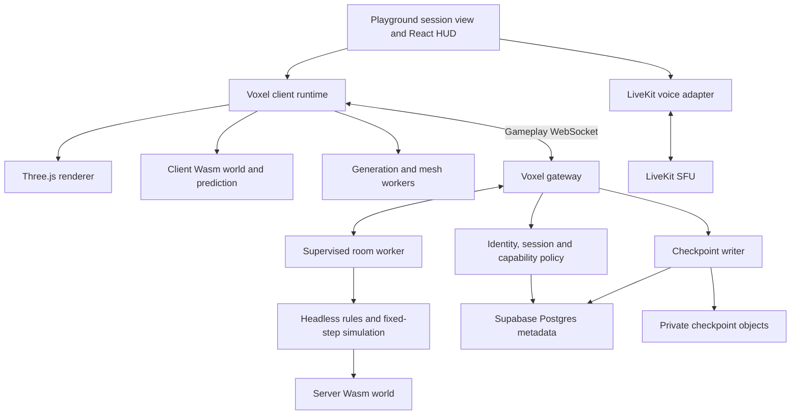

# Voxel game rewrite proposal

**Status:** Implementation is in progress under the user's rewrite request; operational cutover remains pending. Current user scope clarifications are recorded below.

**Date:** 2026-10-21.

**Working branch:** `dev/voxel-runtime-rewrite`.

**Evidence:** Exploratory measurements summarized in section 2; supporting raw research artifacts are maintained separately from this document.

**Candidate baseline:** [Blockyard a79346108fc5ed3b68e3827608fdb448e5a7e5db](https://github.com/Potrock/blockyard/tree/a79346108fc5ed3b68e3827608fdb448e5a7e5db).

## 1. Recommendation

Replace the voxel game implementation with a new game built on a maintained fork of Blockyard's Rust/WebAssembly engine and Three.js rendering pipeline. Build a new authoritative game simulation, protocol, content model, persistence format, and client integration around those foundations. Reuse useful upstream simulation components where they satisfy the new contracts; do not recreate its entire game platform.

The current source is evidence of intended behavior and known problems. It does not constrain the replacement's structure, dependencies, numeric IDs, APIs, database representation, or visual design. Existing test worlds and saved voxel state need no migration. Existing gameplay code may be discarded completely. A small helper is worth reusing only when it fits the new design and has convincing tests.

Preserve chosen **product capabilities**, not their implementations. Supabase identity, school access policies, Playground sessions, teacher supervision, and voice are valuable services and requirements; even their voxel-facing adapters should be rewritten where appropriate. Retaining React for the surrounding application does not require retaining the current session container, HUD, socket hook, or engine lifecycle.

This is a full voxel rewrite, not a performance patch to NOA, a Babylon-to-Three syntax conversion, or a wrapper around the old server. It also does not require rewriting unrelated board games or classrooms merely because they share files with the voxel server today.

## 2. Why this direction is justified

| Observation | Consequence |
| --- | --- |
| Our server accepts browser-reported player positions | Movement authority and all position-dependent validation must be rebuilt. |
| Nearby terrain generation and NOA meshing can occupy the browser main thread | Generation, meshing, readiness, and upload scheduling need a different pipeline. |
| Custom block edits rebuild complete object systems; material URLs fragment terrain batching | Replace the terrain/object rendering model rather than optimizing individual callbacks. |
| Client, protocol, voice, presentation, and server services are tightly coupled | Establish enforceable module and process boundaries. |
| Blockyard's release Wasm generated columns at 2.20 ms mean and lit/meshed them at 2.67 ms mean on our two-core ARM host | Its existing engine is a credible foundation; there is no justification yet for writing another engine from scratch. |
| A minimal 16-player candidate room averaged 0.97 ms per 30 Hz tick | An authoritative Node/Wasm simulation is practical enough to develop further; full survival capacity remains unmeasured. |
| Wasm prediction and selected headless multiplayer tests passed; two software-rendered browser clients exercised workers, shared edits, and streaming | We have functional evidence beyond a README or isolated native benchmark. |
| A real-socket burst moved 27.84 blocks versus 3.88 normally in roughly one second, below the message limit | Candidate movement-time accounting is unsafe to adopt unchanged. |
| Candidate storage allows only 68 custom variants after its built-ins | The registry/storage contract must change before our content grows around it. |

These measurements do not establish hardware FPS, classroom concurrency, long-session stability, or a Rust-versus-TypeScript speed ratio. The two terrain generators produce different worlds. The candidate probe measured 81 generated columns, 49 natural-terrain mesh jobs, and 300 measured ticks per room workload. Eight selected upstream headless test files passed. The native engine suite reported 77 passed, 1 failed and 3 ignored; the failure is a floating-point physics fingerprint on Linux ARM, consistent with an upstream-documented platform difference but not independently diagnosed as its sole cause. The browser check used software rendering at a small viewport and establishes functionality only. Supporting local artifacts, including raw timings and failure output, are in `research/voxel-runtime/`; they are outside this standalone proposal.

## 3. Decisions and proposed defaults

These are recommendations for the rewrite, not claims that the implementation already exists.

| Area | Proposed decision | Reason |
| --- | --- | --- |
| Compute engine | Fork the pinned Rust engine; compile the same Wasm artifact for browser and Node | Reuse working generation, collision, raycasting, lighting, meshing, and culling. |
| Renderer | Adopt and simplify the candidate Three.js/WebGL2 pipeline | Its mesh formats, shaders, texture arrays, and culling already fit together. |
| Simulation | Headless TypeScript domain simulation around the Wasm primitives | Rules remain approachable without coupling them to rendering or transport. |
| Gameplay transport | Dedicated WebSocket connection using `ws` on Node and the browser WebSocket API | Fits the candidate's ordered state stream and avoids adapting its prediction to legacy events. |
| Time | 30 Hz authoritative world tick, two fixed 60 Hz player-movement steps per tick | A single movement contract can be replayed by the client at render-independent input intervals. |
| Network cadence | Sample controls at 60 Hz, batch at 30 Hz; begin with 15 Hz remote snapshots | Separate input, simulation, replication, and rendering costs; tune from measured behavior. |
| Block storage | Uint16 block-state IDs, with one compiled content manifest | Remove the candidate's small custom-block pool and our duplicated render/gameplay definitions. |
| World shape | Start with 256-block height; propose a configurable 512×512 playable area | Retain the engine's vertical format while bounding exploration, memory, persistence, and supervision costs. |
| Persistence | Immutable checkpoint data in private Supabase Storage, committed through a small Postgres manifest/pointer | Durable recovery without local-disk assumptions or a growing `game_sessions.game_state` blob. |
| Isolation | One simulation worker per active room, supervised by a thin gateway | Keep room computation away from socket/admission work and unrelated classroom services. |
| UI | A rewritten React HUD and session view around an imperative game runtime | Consistent Hebrew/accessibility behavior without putting the game loop in React. |
| Existing saves/protocols | Reset test state at cutover; no compatibility layer | The game is unlaunched and the user explicitly waived backward compatibility. |

**User decision: no maximum-player, observer-count, or maximum-room caps.** Do not inherit Blockyard's player/room defaults, add configurable headcount ceilings, or turn a benchmark workload into a join restriction. The 16-player experiment is one measured sample, not a proposed maximum. Input queues, message sizes, worker scheduling, and other internal work budgets are separate implementation concerns, not player/room-count caps.

**User clarification — 2026-10-28: this is a private-school application, without a scale-building requirement.** Prioritize complete student/teacher workflows and reliable play, voice, saving and recovery on school devices. The 128-player profiles are historical diagnostics; their performance is not a release gate. Stop progressively larger synthetic load experiments and do not add scaling infrastructure for this rewrite. Validate ordinary school use without introducing headcount restrictions.

**Device clarification — 2026-10-28: students mostly use PCs.** Desktop keyboard/mouse input and school PC browsers are the release focus. Mobile/tablet compatibility and performance are optional; do not add work or block release for that matrix. Retain existing touch behavior where practical.

The world size and launch device floor remain proposed product defaults to ratify before release. Expected participation and simultaneous sessions are workload inputs for testing and infrastructure planning, not limits on allowed users or rooms.

### Alternatives considered

- **Continue NOA/Babylon and optimize locally:** useful for a narrow maintenance task, but leaves most authority, lifecycle, content, and networking work unresolved. It would spend effort around an architecture we intend to replace.
- **Build a fresh Rust or TypeScript engine:** excessive initial engine work given the functioning candidate. Reconsider only if registry widening or real-device validation reveals a fundamental mismatch.
- **Adopt all of Blockyard:** brings public accounts/lobbies, a general game API, uploaded games, replays, and many unrelated systems into a school game. Select subsystems and keep provenance instead.
- **Adopt Colyseus:** remains a reasonable platform default for other action games. Here it would add a second replication model around a working native protocol/prediction stack. Use a voxel-specific WebSocket runtime and document the exception.
- **Native Rust server:** possible later, but currently duplicates TypeScript rule/API work without an observed Node bottleneck. Both server and browser initially execute the same Wasm engine.
- **WebGPU, SharedArrayBuffer, WebTransport, a new ECS framework:** no demonstrated need for the first release. Reconsider a specific dependency when a measured limitation justifies it.

The existing Socket.io ADR remains valid for other services. The voxel exception should receive its own accepted ADR during implementation; this proposal does not retroactively change deployed architecture.

## 4. Product scope

There is no automatic feature-parity requirement with every current edge case. There must be an explicit inventory of the experience we intend to ship.

| Capability | Proposed release scope |
| --- | --- |
| Creative and survival modes | Both required. Creative is the first working slice, not a substitute for completing survival. |
| Building, mining, block targeting, ladders, slabs, stairs, plants, glass, torches | Required with matching visuals, collision, light, and interaction shapes. |
| Hotbar, inventory, equipment, 2×2/3×3 crafting, containers, item drops | Required through the new unified item model. |
| Tool wear, food, health/hunger, fall damage, combat, death/respawn, TNT | Required, with server-owned outcomes and deliberate tuning. |
| Equipment perks | Retain the intended capabilities through data-driven modifiers; old constants and implementation details are negotiable. |
| Terrain, biomes, day/night, ambient audio, basic weather presentation | Use candidate generation/art foundations; redesign terrain composition and visual style as needed. |
| Weather-driven block simulation and elaborate weather effects | Deferred proposal, requiring product acceptance of that scope reduction. |
| Teacher observation/play modes, room controls, supervision and moderation | Required; capabilities enforced by the backend. |
| Proximity voice, mute controls, chat | Required; retain LiveKit as the media service with new engine-independent adapters. |
| Hebrew UI, RTL text/layout, pointer lock, fullscreen and keyboard/mouse controls | Required on school PCs. Existing touch controls are best-effort; mobile/tablet compatibility is not a release gate. World axes, movement, and camera are not mirrored for RTL. |
| Saved sessions, reconnect, room pause, recess closure, recovery after restart | Required against the new persistence/lifecycle model. |
| Mobs, vehicles, guns, micro-voxel destruction, public matchmaking, user-uploaded games | Outside this rewrite's release scope unless separately requested. |

Start with one coherent terrain preset and a representative content set; expand after the complete building/survival loop works. Do not spend the foundation stages reproducing all old biome formulas, incidental bugs, or renderer-specific asset formats. Inventory every existing block/item/recipe and explicitly mark retain, replace, combine, or remove before the content-completion stage exits.

## 5. Target boundaries



The browser main thread owns input, prediction, camera, audio presentation, and GPU submission. Workers own generation, lighting, and meshing. Each Wasm instance has its own memory; sharing a compiled module does not share world state. The server's loaded world and simulation remain authoritative.

### Repository layout

Follow the existing pattern of integrated native runtimes under `games/`, with game dependencies isolated from the web application's dependency set:

```text
games/voxel/
  engine/                 # Rust fork, tests, wasm bindings
  content/                # semantic block/item/recipe definitions and localization keys
  src/shared/             # content contract, movement contract, protocol and validation
  src/sim/                # headless world, actors and survival systems
  src/client/             # prediction, interpolation, input and presentation
  src/render/             # Three.js pipeline and shaders
  src/world/              # streaming, jobs, edits and revision handling
  src/server/             # room worker, lifecycle and snapshot construction
  tools/                  # content compiler, build/boundary checks and benchmarks
  tests/
  package.json
  package-lock.json
  UPSTREAM.md
apps/voxel-server/         # HTTP/WS gateway, platform policy, room supervision, durable IO
apps/classroom-server/    # classroom/RTC responsibilities currently mixed into Minecraft
apps/web/src/games/voxel/  # rewritten React session/HUD integration
```

Names are proposed. Do not create additional generic engine packages until a real second consumer needs them. The engine and simulation cannot import React, Supabase, LiveKit, or application components. The gateway injects policy, persistence, and audit ports. The client exposes a small mount/dispose/command/subscribe interface; React never reaches into engine internals.

Import checks and browser-bundle checks enforce these boundaries. Match compiled engine, content, protocol, and client/server artifacts by build identifier. No runtime fetch from upstream Blockyard hosting or dependency on its accounts, telemetry endpoints, or public servers.

## 6. Engine fork and content contract

### Widen the block-state format early

Adopt Uint16 storage, keep air at zero, and reserve an explicit unloaded/keep sentinel. Prefer stable semantic names in authored content, with deterministic numeric IDs assigned by the content compiler. A block family and its oriented/half variants are distinct concepts. Items are not constrained by the voxel block-state width.

This is a format change, not a search-and-replace. Update and test generation buffers, sparse sections, block registries, collision/shape tables, blueprints, mesh-neighborhood extraction, world edits, serialization, and JS/Wasm bindings. Distinguish block-state IDs from texture-layer indices and packed vertex fields; widening storage does not automatically require widening every vertex. Version each binary format and reject mismatches.

Remove the special allocation of 187 reserved built-ins plus a small custom pool. Stock content should be ordinary input to our content compiler, so unwanted definitions can be removed and useful definitions extended without preserving upstream numbering.

Gate this change with u8-boundary-crossing tests (IDs above 255), shape and light equivalence, real Wasm round trips, and remeasured memory/job costs. Retain 256-block height initially; avoid coupling this necessary registry change to an unnecessary vertical-world rewrite.

### One source for behavior and presentation

A block definition supplies state variants, render geometry, collision and selection geometry, render layer, light emission/transmission, replacement/support rules, mining/tool requirements, drops, sound group, and localization key. Derived engine/render tables must agree. A block's visual shape is not automatically its collision shape, and non-air is not a collision predicate.

Compile definitions to a canonical manifest with a content hash, engine tables, and typed lookup bindings. Load engine tables into Wasm at startup in each instance; ordinary content edits should not require recompiling Rust. Validate unknown references, duplicate keys, invalid state combinations, recipes, texture layers, and shape bounds during the content build.

Use one stack model: `itemType`, `count`, and optional instance data such as durability. A placeable item refers to a block family/state-placement policy. Use the same stack representation in hotbar, storage, crafting, equipment, containers, and world drops. Eliminate the current dual `blockId`/`itemId` stack representation and separate block-versus-item drop branches.

Prototype art can use the candidate's procedural textures and audio. Choose a coherent visual style before expanding assets. Record provenance and redistribution terms for every imported asset; the repository's code license alone is not an asset inventory.

## 7. Simulation, movement and authority

### Time and input

Use a monotonic server scheduler and a fixed 30 Hz world step. Player motion advances through two fixed 1/60-second substeps using shared code on server and client. A stalled server may execute a bounded number of accumulated world steps; it never grants one client extra simulated time because that client's input queue is long. Report persistent overruns and improve scheduling or scale resources instead of creating an unbounded catch-up spiral or imposing headcount ceilings.

Input frames contain a sequence number, controls/axes, view orientation, and connection epoch. The server does not accept a movement duration, world position, velocity, damage result, fall distance, or client-selected clock as authority. It consumes at most one scheduled control frame per movement substep, rejects duplicates, and bounds queued input age/count. Proposed initial cap: 12 frames (200 ms). Old excess input is discarded with an explicit resynchronization response; discarding input never advances the player.

Define behavior for missing input: briefly retain eligible held movement, neutralize after a short deadline, and clear transient presses once consumed. Pausing, death, role changes, focus loss, disconnect, and teleport invalidate the relevant prediction/input epoch. Buffered commands from before those boundaries cannot apply afterward. Measure the holding/jitter-buffer policy under loss of connectivity before choosing final deadlines.

The client samples controls and predicts at fixed 60 Hz independent of rendering frequency, retains bounded unacknowledged inputs, and reconciles from authoritative state plus the last processed/discarded input boundary. Smooth small visual corrections; snap teleports and role changes. Side effects such as sounds, damage, item consumption, and spawned drops cannot repeat during replay.

The candidate burst reproducer must pass after this replacement. Add sustained bursts, repeated sequences, reconnect replay, altered input frequency, stall recovery, and large client time claims. A message-rate limit is not a movement-time limit.

### Domain systems

The room owns players, world state, inventories/containers, drops, timers, and combat state. Systems consume commands and produce state changes and typed events. Rendering and HTTP calls never execute inside those systems.

Mining starts from a server-validated target/tool and completes on server simulation time; the client can cancel or display progress, but cannot award completion. Placement, combat, chest access, pickups, and TNT use authoritative position, collision-aware reach/line-of-sight, permissions, and mode rules. Hunger, equipment, water/ladder behavior, and damage modifiers feed the same movement contract used by prediction.

Inventory moves, crafting, world edits, tool wear, and resulting drops commit as atomic room operations. Commands carry an action ID, epoch, and relevant container revision; repeat delivery within an epoch returns the prior cached outcome while retained, or is rejected as retired after eviction. Replay protection must survive result-cache eviction: retain an independent rejection boundary, such as an ordered action-sequence boundary, so an evicted action can never execute again. Test replay after filling and evicting the result cache, verifying no repeated gameplay effects. Reconnect/restart rejects old-epoch actions and installs a new baseline before the UI offers a retry; it cannot silently resubmit an unacknowledged craft or inventory move. Concurrent container interactions use revisions and serialized room commands, not an exclusive lock for the entire time a chest UI is open. Conflicts return authoritative state without duplicating or silently destroying items.

Use seeded simulation randomness and simulation-time timers for gameplay. Wall time is reserved for admission, lease deadlines, access policy, and operations. Paused game time freezes hunger, mining, fuses, weather mutations, damage and pickups; opening an individual inventory does not pause the whole multiplayer room.

## 8. Replication and connection lifecycle

Maintain one shared protocol schema/validator source and versioned encoders. Start control, input, and ordinary snapshot messages as bounded JSON with quantization and field deltas. Send bulk chunk/edit payloads in versioned binary frames; do not base64-encode large buffers into JSON. Add further binary encoding only where traffic/CPU measurements justify it.

Remote actors are rendered through a server-timestamped interpolation buffer, initially about 100–150 ms and bounded adaptively. Prediction, simulation, and snapshot intervals are separate settings. Cap extrapolation and surface a stalled connection. Roster changes, removals, discontinuities, and observer visibility have explicit messages rather than being inferred from a partial player delta.

Scope replication deliberately:

- Nearby actors and world chunks follow an approved interest radius around the authoritative actor or staff observer camera.
- Personal inventory, crafting state, and private command results go only to their owner. Container contents go only to authorized viewers.
- Teachers may receive a lightweight room roster and supervision data without receiving every entity, inventory, or distant mesh.
- Inspect actual compression cost before enabling it by default. Drop obsolete queued snapshots when a socket is backpressured, preserve the ordered world-event baseline, and resynchronize/disconnect a client that exceeds a bounded backlog.

### Joining and reconnecting

1. The app requests admission using its Supabase session. The gateway verifies session/game, identity, membership/invitation, role, gender policy, recess, and lifecycle. It does not reject a valid join because a player or room count reaches a configured ceiling.
2. A short-lived, session-scoped, single-use ticket authorizes the WebSocket handshake. Do not put reusable access credentials in URLs or browser logs.
3. The server sends the build/protocol/content/world versions and connection epoch. Incompatible clients receive a reload/unsupported response before simulation begins.
4. Subscribe to a chunk at revision `r`, obtain its procedural manifest plus edit baseline, and buffer subsequent edits while generation is pending. Install data and replay revisions after `r`; gaps trigger chunk resync. Chunk installation cannot overwrite newer changes.
5. Spawn only when the server has valid collision data and the client has installed the required nearby collision state. Render readiness can follow separately.
6. Reconnect obtains fresh admission and a fresh authoritative baseline. Keep the player's durable identity and inventory; do not replay old transport commands. Proposed reservation grace: 30 seconds, configurable independently of access revocation.

## 9. World streaming, rendering and presentation

Keep sparse 16³ sections grouped into columns, deterministic seed/config generation, and chunk-indexed edits. Hot world queries read loaded block buffers rather than rerunning procedural generation. Generation and edit storage remain bounded by the playable area and loaded radius.

Every browser job identifies the world instance, chunk incarnation, content/generator versions, and revision. Cancelling/reloading a chunk invalidates its old incarnation. Validate identity on generation results as well as mesh results. Worker failure retries are bounded; freeze movement into unavailable terrain and show recovery state instead of installing empty data or generating synchronously as a fallback.

Use distance/direction/collision urgency to prioritize jobs. Compile Wasm once per page and instantiate bounded worker pools. Begin with one worker on two-core devices and a cap of four on larger devices, subject to measured results; do not blindly allocate hardware concurrency minus one. Limit queue depth and GPU uploads, initially targeting a 2 ms upload budget per frame. Use separate collision-data, mesh-ready, and uploaded states.

Use the candidate's packed mesh pipeline, shared texture arrays, opaque/cutout/translucent passes, shape meshing, and section/cave culling. Static blocks and shapes belong in chunk geometry. Use instancing for appropriate repeated moving objects. Avoid a scene node per plant and a dynamic scene light per torch.

Retain voxel skylight/block light and AO. Invalidate only affected neighborhoods, coalesce multiple edits, and version lighting/mesh batches. Bound how long coordinated swaps wait and report timeout/failure; do not promise perfectly atomic visual updates under all conditions. Expensive water effects, high-resolution shadows, bloom and god rays are quality options, not prerequisites for a usable world.

Keep the camera, first-person arm/tool animation, third-person avatars, break feedback, and spatial sound as presentation systems. Use chunk-local coordinates plus an explicit camera-relative transform for GPU precision; collision and persisted world coordinates remain authoritative. Test origin/coordinate shifts across terrain, instances, avatars, targeting, particles and audio together.

React subscribes to low-frequency HUD state and events; it does not receive every transform or raw snapshot. The runtime has one owner and a deterministic teardown that cancels jobs, disposes geometry/material resources, disconnects listeners, and releases pointer/audio ownership. Voice consumes a renderer-independent spatial interface; it must not depend on NOA entities or private Three.js scene fields.

## 10. Durable state and ownership

### New save format

Persist world ID, schema/generator/content versions, seed, preset/bounds, simulation clock, changed chunks, containers, player inventory/equipment/vitals/position, and durable dropped objects. Define whether timed objects such as primed TNT freeze across saved pauses; recommended behavior is to persist remaining simulation duration and resume it exactly, rather than elapsed wall time detonating objects while the room is closed.

Create immutable checkpoint objects in private storage. Reuse unchanged chunk references; write dirty chunks and one coherent actor/container/timer snapshot from the same simulation boundary. Upload objects first, then commit a Postgres manifest and advance the active checkpoint pointer in one transaction. Compare owner epoch and checkpoint sequence so late writes cannot replace newer state. Upload success alone does not make a checkpoint active. Clean abandoned/unreferenced objects asynchronously after a retention window.

Use the gateway for asynchronous storage IO; snapshot construction must not stall rendering or the room tick. The worker captures/copies or transfers an immutable snapshot so subsequent mutations cannot change an in-flight save. Bound pending snapshots and coalesce autosaves without losing explicitly requested pause/stop saves.

Proposed autosave interval: 15 seconds, with a launch target of no more than 30 seconds of durable lag during healthy operation. Accepted gameplay commands are not all synchronously durable: a crash can lose changes since the last committed checkpoint. Pause/stop/last-player-leave acknowledge successful saving only after commit; failures display an unsaved/retrying state and preserve the last valid checkpoint. A forced shutdown can still lose unsaved changes. If a tighter recovery objective is required, add a durable command journal deliberately instead of implying snapshots provide zero-loss recovery.

### One owner per world

The gateway maps a Playground session to one authoritative worker. Concurrent joins resolve idempotently. Use a small durable owner lease/epoch to fence restarts or overlapping deployments; checkpoint writes require that epoch. A gateway that cannot renew ownership must freeze/disconnect its room before the lease expires. Fencing storage alone does not prevent two live simulations, so lease loss must also stop publication/input processing.

A single voxel gateway deployment can be the initial topology, with additional hosts introduced as measured demand requires. Do not impose a maximum number of rooms or players. Postgres owns allocation metadata; room workers own gameplay. Do not add Redis, Kubernetes, a distributed actor framework, or seamless live-room migration without a measured need. A worker crash restores the last checkpoint through a new epoch; it does not resurrect another worker's stale command queue.

## 11. Playground, teacher and RTC integration

Keep the existing catalog/invitation/session journey as the user entry point, but implement its voxel-facing adapter anew. There is no separate Blockyard launcher, guest-account flow, public lobby, or Discord identity. Every in-game identity maps to an admitted Playground identity.

Represent room host and teacher/admin abilities as explicit capabilities. Host ownership is not physics authority. A hidden staff observer is a distinct non-colliding observer actor, filtered from student replication and denied survival actions by default. Switching to participant mode, teleporting, pausing/stopping, mode changes, muting, and moderation are validated server commands with appropriate operational/audit records. Camera position, observer interest radius, and read access are bounded too.

Define lifecycle centrally: preparing, playing, paused, ended, and recovering. The gateway projects these to the platform's session statuses; browsers cannot independently persist conflicting states. Recess closure revokes gameplay/input and follows the chosen pause/save policy. A transient reconnect ticket cannot override expired recess, removed membership, or revoked staff authority. Last-player departure saves and releases the room; host departure reassigns allowed controls without changing simulation ownership.

Keep LiveKit for media because changing the renderer gives no reason to replace a working SFU. Rewrite proximity audio against semantic player transforms and a world-occlusion query. Teacher mute controls require enforcement through server-issued grants/moderation policy as appropriate, not merely a cooperative local mute flag. Test PC browser permission denial, output selection and reconnect. Mobile audio activation is optional. Chat remains platform-moderated and appropriately persisted.

Extract the classroom/RTC responsibilities currently mixed into `apps/minecraft-server/src/index.ts` into a dedicated classroom service. Classrooms must not inherit voxel room CPU costs, restart behavior, or its release cadence. The voxel gateway owns its own token authorization endpoint; share small policy/token helpers only where genuinely common. HTTP paths can be routed to the appropriate service without requiring the same process. No classroom behavior is removed by retiring the old game server.

## 12. Tooling, upstream maintenance and delivery artifacts

Pin the initially tested Node 24 and Rust toolchain versions, npm/Cargo lockfiles, upstream revision, and Wasm compiler/optimizer settings. Build the engine once per release and serve content-hashed artifacts with matching manifests. Initial page load validates required WebGL2, Wasm/SIMD and worker support and shows a useful unsupported-device state when needed.

Maintain `UPSTREAM.md`: imported paths, original commit/license, modifications, excluded upstream features, and an update procedure. Keep meaningful patches focused and retain the burst reproducer as a regression test. Review upstream updates deliberately; do not pull main automatically into releases. Preserve applicable MIT notices and asset provenance. Exclude upstream arbitrary-code development commands, game uploads, account services and public matchmaking from production entry points; test that fabricated development commands are rejected by a release server.

Provide root development/build/check commands that build matching Wasm, content, client and server artifacts, start the required processes, and explain restart boundaries. Keep hot reload for TypeScript/content where safe; Rust edits rebuild the engine. Do not add a second UI framework or a universal platform SDK solely for this game.

CI checks content compilation, import boundaries, client bundle separation, native invariant tests, actual Wasm tests, domain/protocol tests, real-socket integration, and browser smoke. Investigate the existing Linux native fingerprint failure: retain meaningful geometry/physics invariants and use appropriately scoped platform fingerprints or numeric tolerances. Do not update a hash or disable a test merely to get a green build. The same release Wasm must be exercised in Node and supported browsers.

Operational logs and audit follow [LOGGING.md](LOGGING.md). Aggregate frame/tick timings, queue lengths, correction magnitude, replication bytes/backpressure, worker failures, loaded-section counts, and checkpoint lag. Correlate reports with engine/content/build/room epoch and device settings. Do not log every input/frame or include auth tokens, chat bodies, voice content, or unnecessary child-identifying data in performance records.

## 13. Delivery stages and exit criteria

Each stage produces a reviewable result; none makes an unfinished game production-ready. The first implementation should run independently before the app adapter is completed. Development visibility is sufficient; there is no need to maintain two permanent voxel engines or support old saves.

| Stage | Deliverable | Exit evidence |
| --- | --- | --- |
| 0. Foundation and decisions | Import pinned subsystems with provenance; content/registry contract; fix input-time accounting; pin artifacts; record product defaults | Reproducible build; an early real-device candidate baseline before extensive format changes; above-255 block/state round trips; burst invariant passes; native failure disposition documented; baseline Wasm/browser checks pass. |
| 1. Authoritative creative slice | Fixed-step room, new protocol, prediction/interpolation, minimal content, worker streaming, targeting/building | Two clients walk, jump, build, remove blocks, join late and reconnect; no forged movement, stale job overwrite, or duplicated command effects. |
| 2. Representative world and presentation | Terrain preset/bounds, shape/texture pipeline, voxel light, avatars/held tools, desktop input lifecycle | Representative school PCs meet initial frame/loading budgets; edits across chunk/light boundaries and travel/unload remain correct. Reject the foundation here if necessary. |
| 3. Survival game | Unified inventories, crafting, containers, equipment/perks, hunger/food, mining, drops, combat/death, TNT | Scenario tests cover the complete survival loop; concurrent inventories cannot duplicate items; content disposition is complete and balancing is reviewed. |
| 4. School integration and saves | New session/HUD adapter, admission, staff roles, voice/chat, recess lifecycle, checkpoint/recovery; classroom service split | Student/staff workflows, save/restart, disconnects and access revocation pass with the actual app; classroom regressions pass separately. |
| 5. School release qualification | Complete student/teacher journeys, supported school devices/networks, save and failure recovery | Signed-off feature matrix and device floor; usable performance during ordinary school play; durability gates below; no untriaged authority/data-loss defects. Large synthetic workloads and scaling infrastructure are not exit requirements. |
| 6. Cutover and retirement | Enable new catalog/runtime path for fresh test sessions, route services, remove old voxel runtime and obsolete docs | New path is independently operable; classroom service is healthy; old NOA/socket/content code and unused dependencies are removed; architecture/docs/skills reflect reality. |

Critical path: registry and time contract → playable authoritative slice → real-device verdict → survival and school lifecycle → school release qualification → cutover. Do not port the full old content set before establishing the new foundations. Do not defer persistence, teacher modes or voice until after calling the game complete.

Effort is concentrated in registry widening, robust time/reconnect semantics, coherent survival transactions, checkpointing, and real-device presentation—not in changing import names. A calendar estimate should be made after stage 0 exposes the actual engine-format patch and stage 1 demonstrates the new control loop. Assigning precise dates from the short exploratory benchmark would be misleading.

## 14. Acceptance targets and validation matrix

These are proposed engineering targets, not results already achieved. Confirm the actual school device/network matrix and expected simultaneous sessions before release qualification; do not infer school capacity from a 16-player flat-world probe.

| Concern | Proposed gate |
| --- | --- |
| Supported school PC | During prescribed movement/building scenarios, foreground frame time p95 ≤16.7 ms and p99 ≤33.3 ms at the documented quality profile. |
| Mobile/tablet | Optional compatibility; no mobile/tablet performance matrix or release gate is required. |
| Main-thread streaming work | Ordinary upload/installation budget targets 2 ms/frame; no recurring game-caused >50 ms long tasks while moving/building after initial loading. Record initial compilation separately. |
| Join readiness | Proposed cold join ≤8 seconds and warm rejoin ≤3 seconds on the specified 10 Mbps/100 ms test profile; readiness means safe collision plus a usable nearby world, not an empty HUD. |
| School workload | During ordinary school play, target integrated 30 Hz tick p95 ≤10 ms, p99 ≤20 ms; no persistent input/save/replication backlog. The 128-player diagnostic is not a release gate and does not become a player cap. |
| Authority | Burst/time-forgery tests, repeated/stale commands, unauthorized role/actions and reach checks pass; no queue length or client timestamp can create movement time. |
| Prediction | Fixed-trace agreement within a defined small tolerance (initial target 1 cm) on unchanged worlds; corrections bounded under network impairment; report input/ack lag as well as positional error. |
| Durability | Crash/restart restores a coherent committed checkpoint; healthy durable lag ≤30 seconds; pause/stop never report saved before commit. |
| Memory | Repeated travel/join/leave cycles plateau in tracked owned buffers/resources and loaded-section counts; Wasm high-water retention is distinguished from live allocation leaks. Establish memory budgets from stage 2/5 measurements without converting them into fixed player/room counts. |
| Multiple rooms | Verify session isolation, teacher controls, saves and cleanup when school sessions coexist. No progressive scale target, scaling infrastructure or room/player-count ceiling is required. |

Use a fixed set of benchmark scenes and scripted paths: varied materials and shapes; dense plants; underground emitters; container/crafting activity; repeated placement/removal; TNT bursts; rapid travel and observer teleportation. Add a sustained multiplayer survival scene, not only a flat movement loop. Record quality settings, resolution, device, browser/build, warmup, sample durations, percentiles, traffic and background-tab status. Software-rendered checks remain functional evidence only.

Test normal networks, 50–150 ms RTT, jitter/bursts, one-to-five-second stalls, reconnect after room restart, and sustained socket backpressure. WebSocket's ordered delivery can turn loss into stalls; simulated packet delay alone is not sufficient. Test across actual devices/networks before launch. Include controls opening/closing UI, focus/visibility changes, permission denial, WebGL context loss, worker crash, persistence outage, lease loss, room crash and process drain.

For correctness, test generated chunk borders across seeds/order, high block IDs, negative coordinates and bounds, lighting seams, shape collision/selection, edits arriving during generation, chunk unload/reload, no item duplication under retries, simultaneous chest access, death/eating/mining cancellation, teacher visibility, capability revocation and recess during reconnect. Verify release Wasm world generation and movement across Node and supported browsers; sharing a codebase does not automatically prove cross-runtime numeric agreement.

## 15. Cutover, removal and rollback

The game has not launched. Build the replacement as the only future voxel runtime, exposed in development until release gates pass. Do not maintain old protocol aliases, numeric-ID mappings, saved-world converters, renderer adapters, or indefinite runtime selection flags.

At cutover, deliberately invalidate/archive test voxel sessions through a scoped operation and start fresh worlds. This document does not perform or authorize a broad database cleanup. Deploy matching client/server/content artifacts; incompatible clients reload. Stop admission, pause/save/drain existing new-format rooms, then replace the backend. Avoid overlapping unfenced owners during deployment.

Remove `MinecraftClient.tsx`, `useVoxelSocket`, mirrored legacy protocol types, custom NOA mesher overrides, obsolete generation/audio/model glue, and the old voxel server implementation once their chosen capabilities exist in the replacement. Remove NOA/Babylon and legacy assets only after checking unrelated consumers. Replace or retire old implementation-specific tests and `.cursor` voxel instructions; preserve behavioral coverage in the new test suite. Update the architecture guide and record scoped supersession of old proposals/ADRs.

Retire `apps/minecraft-server` only after classroom/RTC responsibilities have their new service and validation. Do not leave a renamed legacy game loop behind as the classroom backend.

Rollback means disabling voxel admission or deploying the previous **new-stack** build with compatible checkpoint formats. It does not mean silently reverting to the old NOA game. During prelaunch development, explicit test-world resets remain acceptable; after real users begin, storage/build compatibility and recovery need a deliberate version policy. Waiving compatibility with today's test worlds does not waive future player-data correctness.

## 16. Remaining decisions and stop conditions

Before release, ratify: the bounded-world default and size; actual device/browser floor; deferred weather scope; required art/content set; and the acceptable recovery-loss window. Use ordinary private-school sessions as qualification context; large-scale capacity planning is not a release requirement. Player and room caps are explicitly excluded by the user decision above. The proposal supplies other defaults without treating the existing implementation as the answer.

Reconsider the candidate foundation if Uint16 conversion makes the engine substantially harder to maintain, representative devices fail basic rendering budgets after sensible quality reductions, or survival/prediction integration requires replacing most supposedly reusable engine contracts. Record those costs and choose an alternative at the early gates rather than continuing because of time already invested.

This document defines the implementation requirements and current user scope. See [rewrite progress](voxel-runtime-rewrite-progress.md) for implemented work and evidence. It does not itself deploy services, publish a site or delete test data.
