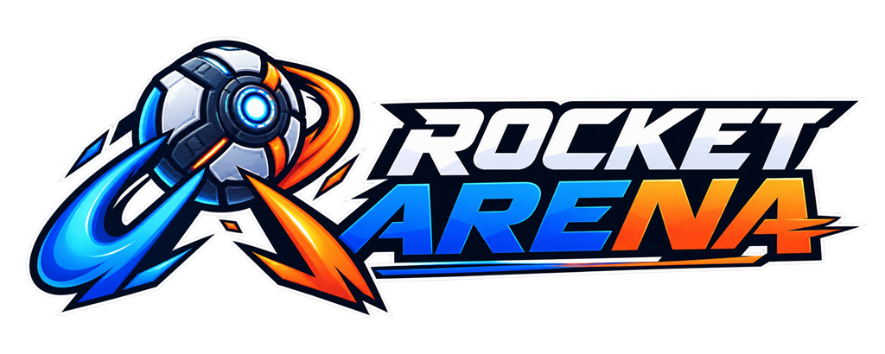

<h1 align="center">
  
</h1>

<p align="center">
  An authoritative browser multiplayer car-ball game built with TypeScript, Rapier, Colyseus, and Three.js.
</p>

<p align="center">
  <a href="https://rocket-arena.endpx.cloud/"><strong>Play it now</strong></a>
  ·
  <a href="#getting-started">Run it locally</a>
  ·
  <a href="#contributing">Contribute</a>
  ·
  <a href="https://github.com/EndPx/Rocket-Arena">Source</a>
</p>

<p align="center">
  <a href="LICENSE"></a>
  
  
  
  <a href="https://rocket-arena.endpx.cloud/"></a>
</p>

> [!NOTE]
> **Status.** Quick Match at 3v3, Custom Rooms up to 4v4, the full regulation and overtime ruleset, eight-car transport, full-surface driving, both boost-pad classes, cameras, HUD, and audio are implemented and playable. Anything unfinished is listed under [Roadmap](#roadmap) rather than left to be discovered.

## Project Status

| Area | Status |
|------|--------|
| Quick Match | Exactly six humans, balanced 3 Blue against 3 Orange, countdown gated on a complete roster |
| Custom Room | Up to eight humans, at most four per team, room-code discovery and Host-controlled start |
| Match flow | Five-minute regulation, above-zero first-to-6 win-by-2, atomic hard cutoff at `0:00`, sudden-death overtime only on a tie |
| Transport | Versioned, validated snapshots carrying as many as eight unique cars |
| Driving | Authoritative Rapier driving, jumps and flips, and full-surface driving across the walls, corners, ceiling transitions, and ceiling |
| Boost | 24 authoritative pads, `6` Large granting `100` and `18` Small granting `12`, with authoritative cooldowns |
| Presentation | Metric arena and goals, deterministic kickoff slots, Ball and Car cameras, accessible HUD, procedural audio, lobby, and an `Esc` match menu |
| Validation | 382 unit, property, and integration tests, seven Rapier harnesses, and physics benches with recorded measurements |
| Roadmap | Proximity-sensitive kickoff selection and demolition, both tracked under [Roadmap](#roadmap) |

## Why Rocket Arena

Rocket Arena exists to make an authoritative multiplayer car-ball game easy to read, run, and change. Clone the repository, install one workspace, and the complete stack starts locally with no accounts, API keys, database, or downloaded gameplay assets.

If you would rather look before you build, there is a [live instance](https://rocket-arena.endpx.cloud/).

Two teams drive physics-controlled cars in a closed arena and knock a ball into the opposing goal. The server owns every gameplay outcome; clients send controls and render synchronized state.

## Core Approach

- **Authoritative simulation** — Rapier 3D physics advances on the server at an exact 60 Hz fixed step. Clients never decide transforms, contacts, boost, scores, teams, or match phases.
- **Deterministic multiplayer rules** — Room capacities, team assignment, kickoff placement, match outcomes, and reset behavior are specified as testable server policies.
- **Bounded netcode** — Server snapshots are sequenced and validated before the client atomically accepts them into its interpolation and presentation state.
- **Procedural gameplay visuals** — Gameplay geometry is built with Three.js primitives. Original locally bundled 2D brand images are presentation-only and never define collisions.
- **Readable boundaries** — The arena shell is painted from the resolved geometry's own material roles and transition heights, so the paint cannot describe a curve the collider does not have. The containment wall is a tinted glass pane with frame mullions, a marked ramp band, and one solid team stripe running the full perimeter, which keeps the crowd visible while still giving a driver height and position to read. A floor disc under the ball reports where it is even when it is high in the air.
- **Boost you can see from across the pitch** — The two pad classes are drawn as different objects because they are worth different amounts. A small pad is a plate set into the turf. A large pad adds a floating orb above that plate, so a full refill is visible at a distance and worth driving to.
- **Evidence-gated tuning** — Confirmed values and unverified Rocket League-style tuning hypotheses are kept distinct; uncertain values remain configurable until deterministic and browser evidence is approved.
- **Accessible presentation** — The HUD exposes team, score, timer, boost, room capacity, camera mode, and match transitions without relying on color alone.

## Multiplayer Rules

### Quick Match

- Exactly **6 human players**.
- Exactly **3 players per team**.
- Deterministic balancing with Blue as the equal-count tie break.
- The kickoff countdown starts only when the room reaches a complete 3v3 roster.
- A pre-match disconnect cancels the countdown; restoring 3v3 starts a fresh countdown.

### Custom Room

- Up to **8 human players**.
- Up to **4 players per team**.
- The first accepted player becomes Host.
- Team switching is allowed only while waiting and only when the destination team has space.
- Only the Host can start a capacity-valid roster.
- Host succession follows stable join order.

Both modes place cars from the same deterministic kickoff-slot table, which defines four canonical slots per team and mirrors Orange from Blue exactly; Quick Match uses three of them. Room mode changes capacity and start policy, not the win condition.

## Match Rules

| Rule | Behavior |
|------|----------|
| Regulation duration | Exactly `300` seconds, represented by `18,000` Active Play fixed steps at 60 Hz |
| Kickoff countdown | Exactly `3` seconds / `180` fixed steps |
| Above-zero victory | After a valid goal while time remains, the scorer wins only when its updated score is at least `6` and its lead is at least `2` |
| Score cap | None; tied and one-goal-lead scores can continue above six |
| Hard cutoff | The fixed step that first reaches `0:00` applies any valid same-step goal exactly once before comparing scores |
| Unequal score at cutoff | The leading team wins immediately, regardless of the six-goal target or two-goal margin |
| Tied score at cutoff | Restore deterministic kickoff state and begin a fresh three-second overtime countdown |
| Overtime | Untimed sudden death; the first valid goal immediately ends the match |
| Ended state | Gameplay controls and authoritative car/ball physics remain frozen; later snapshots preserve one immutable final result |

Boundary examples during regulation while time remains:

- **Immediate wins:** `6-4`, `7-5`, `8-6`.
- **Continue after reset:** `5-3`, `6-5`, `6-6`, `7-6`.

At the hard cutoff, unequal examples such as `5-4`, `5-3`, and `6-5` award the leader immediately. Only a tie enters overtime.

## Getting Started

### Play the hosted build

A live instance runs at **[rocket-arena.endpx.cloud](https://rocket-arena.endpx.cloud/)**. There is nothing to install: open it, choose **Custom**, create a room, and press **Start Match**. Share the room code to play with someone else.

### Run it locally

Prerequisites:

- Node.js 22 or newer, with npm
- A desktop browser with WebGL and WebSocket support

```bash
git clone https://github.com/EndPx/Rocket-Arena.git
cd Rocket-Arena
npm install
npm run dev
```

This launches:

- Colyseus server: `ws://localhost:2567`
- Vite client: `http://localhost:3000`

One browser tab is enough to get on the pitch: choose **Custom**, create a room, and press **Start Match**, because a Custom Room's Host can start any capacity-valid roster including a roster of one. Open a tab per additional player to fill a room, up to eight. Quick Match deliberately does not start until a complete 3v3 roster is present, so it needs six tabs to see a kickoff.

If PowerShell reports that `concurrently` is not recognized, run `npm install` from the repository root before retrying `npm run dev`.

## Controls

| Key | Action |
|-----|--------|
| W / Up | Accelerate |
| S / Down | Brake / Reverse |
| A / Left | Steer left |
| D / Right | Steer right |
| Q / E | Air yaw while airborne |
| Space | Jump (hold for the sustained first jump) |
| Shift | Boost |
| Ctrl | Powerslide |
| C | Toggle Ball / Car camera |
| Esc | Open the match menu |
| ` (backtick) | Toggle the development panel in development mode |

The same key list is rendered along the bottom edge in-match, generated from the
real bindings rather than maintained by hand, and can be hidden in Settings.

Air pitch and air roll are read from the ground axes: while airborne, W/S pitches
the nose and A/D rolls the car. The inversion settings act on the airborne half
only, so a player can fly nose-down without steering backwards on the ground.

## Cameras

`C` toggles the two cameras. Both hold the horizon level; neither rolls with the car.

**Ball Camera** frames the car against the ball. The camera sits on the far side of the
car from the ball, so the car is always between the viewer and the ball whichever way it
happens to be pointing. Using the car's own heading instead looks identical while driving
at the ball and fails the moment you turn away from it, because the camera then ends up
between the ball and the car and aims away from your own car.

**Car Camera** looks where the car is going, and follows it onto a wall. The chase offset
normally lies in the world-horizontal plane, which stops meaning anything once the nose
points at the sky, so while a car is climbing and measurably travelling the offset follows
the direction of travel and takes its height from the chassis roof, the axis pointing away
from whichever surface the car is on. Gating that on measured travel rather than on
orientation alone is what stops an air roll or a flip from swinging the view.

Both are measured by `bench/ball-cam-diagnostic.ts`.

## Match Menu and Settings

`Esc` opens a menu that is local to the player. The match keeps running behind it;
this is not a pause, and gameplay input is suspended and flushed so a key held as
the menu opened cannot leave the car driving into a wall.

| Action | Behavior |
|--------|----------|
| Resume | Close the menu and hand input back |
| Settings | Open the settings panel |
| Return to Lobby | Leave the room and go back to the lobby |

Settings are stored locally under `rocket-arena-settings-v1` and applied before the
first frame on a later visit. A blocked, full, or corrupt store degrades to
defaults rather than failing.

| Setting | Default | Notes |
|---------|---------|-------|
| Sound volume | Project default | Owned by the audio manager; the panel is a view of it |
| Mute sound | Off | As above |
| Ball floor marker | On | The floor disc that reports where the ball is |
| Control hints | On | The on-screen key reference |
| Shadows | Off | Costs a render pass; see below |
| Invert air pitch (W / S) | Off | Airborne only; driving is unaffected |
| Invert air roll (A / D) | Off | Airborne only; steering is unaffected |
| Invert air yaw (Q / E) | Off | |
| Reset to Defaults | — | Disabled while nothing differs from the shipped defaults |

Inversion is airborne only. Driving and steering on the ground are never flipped,
and arranging that needs no grounded flag: the server consults pitch, roll, and yaw
only while a car is off the ground, so flipping those three is air-only by
construction. It is also applied to the command this client builds and to nothing
else, so the server keeps one sign convention and is never told an axis was
reversed.

Shadows ship off rather than absent. One directional key light over a 102 m field
produced large blocky blobs that read as dirt on the turf and competed with the
ball's floor circle for the same cue, so the default is off and the toggle is there
for a player who wants them. Turning them on recompiles the affected materials,
because whether a material samples a shadow map is baked into its program.

## Boost

| Property | Value |
|----------|-------|
| Starting inventory | `100` |
| Consumption | `33.3` units per second while held |
| Large pads | `6`, each grants a full `100`, returns after `10` seconds |
| Small pads | `18`, each grants `12`, returns after `5` seconds |
| Full tank | The pad is still taken and goes on cooldown; the grant is `0` |
| Partial tank | A grant is clamped to the cap, so `95` boost takes `5` from a small pad |

Pad pickup, inventory, and respawn are authoritative and stepped on the server.
Positions come from one shared table that the room grants from and the renderer
draws, so a drawn pad is always a pad that pays out.

Pad availability is authoritative and carried by the snapshot, so a spent pad is
drawn spent and recharges on screen. The snapshot lists only the pads currently on
cooldown, with the seconds each has left, which keeps the usual cost near zero and
means a client that joins part-way through a cooldown shows the correct progress
immediately instead of restarting the sweep. A client is never asked to guess: it
cannot know that another player took a pad.

Two deliberate divergences from Rocket League, both by project decision and both
stated rather than hidden. Boost starts at `100` instead of `33`, and is classified
in the tuning registry as a hypothesis across the full `0`–`100` range rather than
pinned. And driving over a pad always takes it: Rocket League leaves a pad standing
when the tank is full, while here the pad is spent and goes on cooldown for a grant
of zero, so a pad always responds to being driven over.

A recharging pad shows a clock wipe: the plate goes dark and a bright wedge sweeps
round from twelve o'clock until the pad returns. The progress is read from the
authoritative remaining time rather than timed locally, so it is a timer a player
can act on rather than a decoration.

## Architecture

```text
Keyboard input
  -> Client input controller
  -> Colyseus WebSocket control messages
  -> Authoritative room and fixed-step scheduler
  -> Rapier world, car/ball systems, scoring, and match flow
  -> Sequenced state snapshots
  -> Client validation and interpolation
  -> Three.js renderer, HUD, camera, effects, and procedural audio

shared/
  -> constants, contracts, schemas, geometry, and tuning metadata
  -> imported by client/ and server/ without importing either workspace
```

Boundary rules:

- `shared/` imports nothing from `client/` or `server/`.
- `client/` and `server/` never import one another.
- All Rapier authority remains in `server/`.
- The client sends control intent only.
- Gameplay constants and tuning metadata are shared and unit-labelled.

## Tech Stack

| Layer | Technology | Purpose |
|-------|------------|---------|
| Physics | Rapier 3D (WASM) | Authoritative rigid-body simulation and CCD |
| Server | Colyseus 0.15 | Rooms, matchmaking, commands, and snapshot transport |
| Client | Three.js | Procedural 3D rendering and presentation |
| Language | TypeScript (strict) | Shared contracts and compile-time boundaries |
| Build | Vite | Client development and production bundling |
| Netcode | Fixed-step snapshots and interpolation | Stable authority with smooth client rendering |

## Testing

Validation is layered, and every layer is runnable:

- Pure unit tests for policies, reducers, validators, geometry, and controller math.
- Deterministic generated property tests with recorded seeds and at least 100 cases per property.
- Room and serialization integration tests for six-player Quick Match, eight-player Custom Rooms, and terminal snapshot coherence.
- Rapier harnesses for body construction, arena containment, goal crossing, grounding, impacts, jump sequences, and resource cleanup.
- Scheduler tests for exact countdown, regulation, same-step cutoff ordering, and suppression of post-cutoff regulation work.
- Physics benches under `bench/` that measure rather than assert, and print the numbers a claim rests on.
- Browser observation for lobby capacity, rendered cars, HUD, cameras, accessibility, and match-result presentation.

```bash
npm run typecheck     # tsc -b across shared, server, and client
npm test              # 382 unit, property, and integration tests
npm run test:physics  # seven Rapier harnesses
npm run build         # server and client production builds
```

Browser observations are presentation evidence only. Reducer, scheduler, integration, and Rapier tests prove authoritative mechanics and timing.

## How Kiro Is Used

Rocket Arena is developed with [Kiro](https://kiro.dev) using a spec-driven workflow.

### Steering

The always-on project guidance defines product scope, technology constraints, repository boundaries, and implementation conventions:

| File | Purpose |
|------|---------|
| `.kiro/steering/product.md` | Product intent, gameplay scope, and definition of done |
| `.kiro/steering/tech.md` | Rapier, Colyseus, Three.js, networking, and validation constraints |
| `.kiro/steering/structure.md` | Workspace layout, import boundaries, and naming conventions |

### Feature Specification

The active Rocket Arena feature specification separates planning from implementation:

| Document | Purpose |
|----------|---------|
| `.kiro/specs/rocket-arena/requirements.md` | EARS-style acceptance criteria and finalized match rules |
| `.kiro/specs/rocket-arena/design.md` | Architecture, data models, state machines, error handling, and correctness properties |
| `.kiro/specs/rocket-arena/tasks.md` | Dependency-ordered implementation and validation plan |

The current requirements, design, and tasks cover exact 3v3 Quick Match, up-to-8-player Custom Rooms, eight-car transport, Rocket League-style mechanics targets, regulation win-by-two, atomic hard cutoff, sudden-death overtime, and truthful staging/release gates.

### Custom Agents and Skills

The workspace includes specialized agents for physics tuning, headless room exercise, boundary checks, and spec auditing. Its project skills guide requirements clarification, dependency-aware planning, and task-by-task implementation.

## Project Structure

```text
Rocket-Arena/
├── .kiro/              # Steering, specs, agents, skills, and hooks
├── bench/              # Physics tuning harnesses
├── client/             # Three.js renderer, input, HUD, audio, and networking
├── docs/               # Provenance and project evidence
├── server/             # Colyseus rooms, Rapier physics, and game systems
├── shared/             # Constants, contracts, schemas, and shared configuration
└── package.json        # Workspace scripts
```

## Things to Try

Once you are in a room, hosted or local:

1. Drive, jump, boost, and score, and watch the timer and HUD stay in step.
2. Drive over a boost pad on an empty tank: a Large pad fills it outright, a Small
   one adds twelve, and a spent pad shows its cooldown sweep on the way back.
3. Build speed along the floor, drive straight into a side wall, and keep boosting.
   The car climbs it. Press `Space` up there to jump off the wall.
4. Press `C` while climbing to switch to Car Camera, which follows the climb from
   below instead of watching it from the side.
5. Press `Esc`, open Settings, flip an air-axis inversion, and confirm the car still
   steers normally on the ground once you resume.

No external services, API keys, accounts, database, or runtime asset download are required.

## Roadmap

Shipped: expanded room capacity, eight-car transport, deterministic kickoff, scripted controller mechanics, full-surface grounding, metric arena and goals, the complete match flow, both boost-pad classes, cameras, HUD and accessibility, and the regression suite.

What is left, and what is deliberately not implied to work anywhere else in this file:

- **Proximity-sensitive kickoff selection.** Slots are assigned deterministically from roster order rather than from who is nearest to which slot.
- **Demolition.** Deferred until it has a behavior contract worth testing against.

Help with either is welcome. See [Contributing](#contributing).

## Implementation Notes

A few decisions are easier to trust with the reasoning attached.

### Full-surface driving

The walls, horizontal corners, wall-ceiling transitions, and ceiling support a car
exactly as the floor does, so you can drive up a wall, and jump while you are up
there. Support stays earned rather than free: the speed-gated slope policy only
widens the accepted surface angle while the car is above the engage speed and drops
it again below the release speed, so a slow car cannot stand itself against a wall.

Both halves are measured rather than asserted, by `bench/wall-drive-diagnostic.ts`
and `bench/wall-jump-diagnostic.ts`. Enabling the tier moved a boosted climb from
6 supported steps to 97, and held the chassis within half a degree of the wall
normal instead of letting it tumble to 90 degrees while momentum carried it. The
jump probe reports support at 6.1 m up the wall and a velocity change of 3.15 m/s
away from the surface against the 2.92 m/s the tuning registry specifies.

### Boost pad layout

The Small layout carries `18` of Rocket League's `28` rather than all of them, by
project decision, because the full set read as clutter at this arena's scale. The
eighteen are a mirrored subset of the real positions, so both halves stay identical
and the spacing stays Rocket League's.

## AI-Generated Brand Art

The lobby wordmark, compact mark, and favicon are original 2D images generated with ChatGPT by OpenAI under maintainer direction, then human-selected, reviewed, and optimized for local use. They are presentation-only and never loaded from remote URLs at runtime. See [`docs/asset-provenance.md`](docs/asset-provenance.md) for per-asset provenance, dimensions, purpose, and review notes.

## Contributing

Issues and pull requests are welcome, whether that is a bug fix, a mechanic that needs tuning, or a documentation improvement. [`CONTRIBUTING.md`](CONTRIBUTING.md) covers the setup, the four checks to run before opening a pull request, and the import boundaries the codebase relies on.

The short version: the server owns every gameplay outcome, `shared/` imports from neither workspace, and where a change comes down to "it feels right", bring a measurement from a bench under `bench/`.

## Acknowledgements

Built on [Rapier](https://rapier.rs), [Colyseus](https://colyseus.io), [Three.js](https://threejs.org), and [Vite](https://vitejs.dev), and developed with [Kiro](https://kiro.dev).

Gameplay mechanics take Rocket League as a reference point for feel and layout. This project is unaffiliated with and unendorsed by Psyonix, and ships no Rocket League assets.

## License

[MIT](LICENSE) © EndPx
